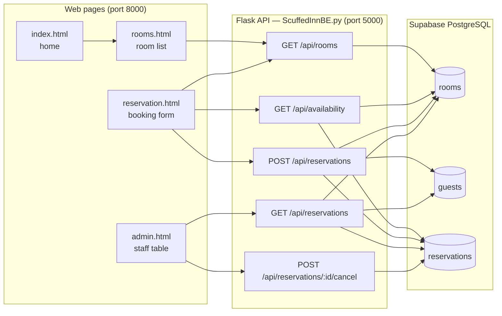
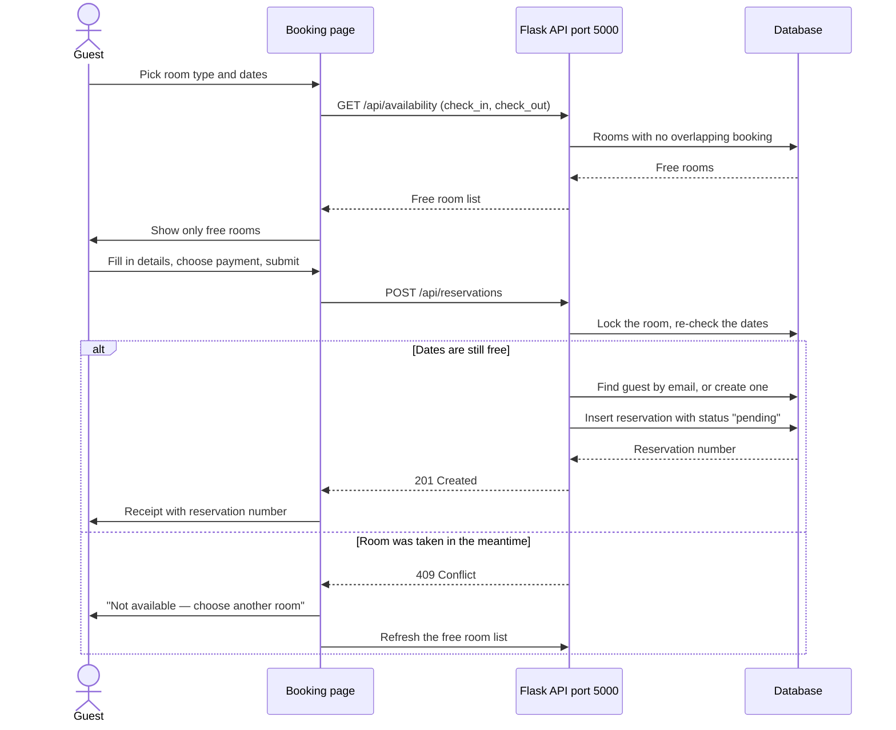
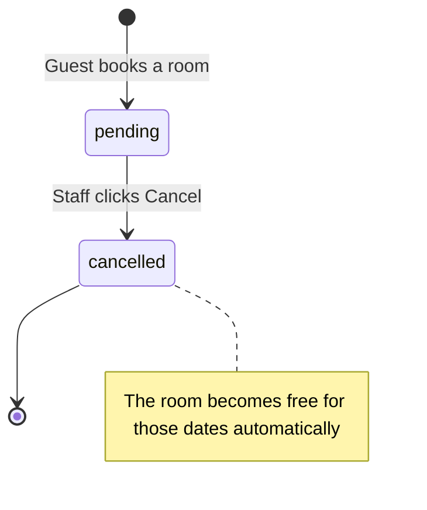
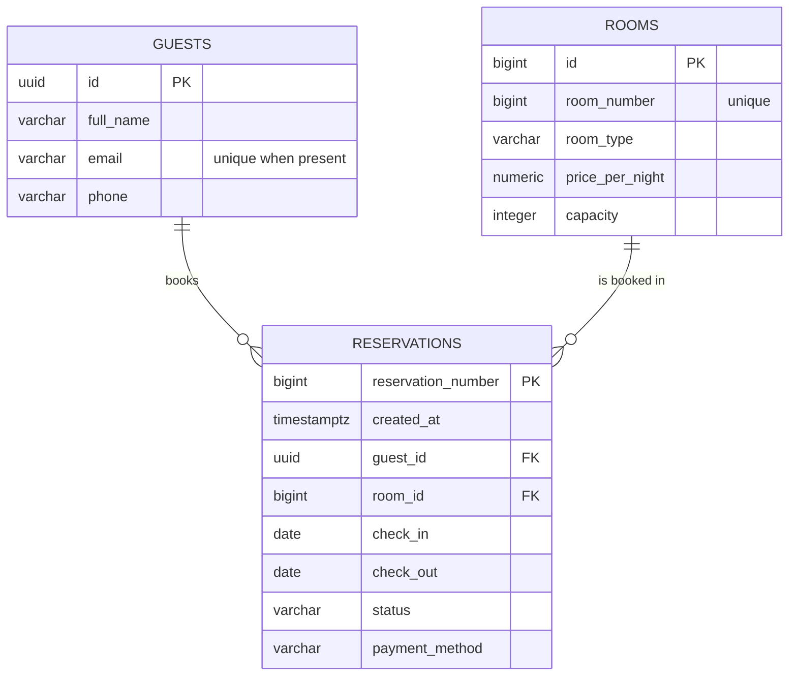

# Scuffed Inn Hotel — Reservation System

A small hotel booking system. Guests browse rooms and book a stay. Staff see every booking and can cancel one. All the data lives in a PostgreSQL database (hosted on Supabase).

There is no build step, no framework, and no npm — just a Python API and a few HTML pages.

## What you can do

| As a guest | As staff |
| --- | --- |
| Browse room types and prices | See every reservation in one table |
| Check which rooms are free for your dates | See guest details, dates, nights, and payment method |
| Book a room and get a reservation number | Cancel a reservation |
| Print or save your booking summary | Refresh the table at any time |

## Contents

1. [What this project is](#1-what-this-project-is)
2. [Quick start](#2-quick-start)
3. [How it works](#3-how-it-works)
4. [Project map](#4-project-map)
5. [API reference](#5-api-reference)
6. [Database](#6-database)
7. [Good to know](#7-good-to-know)
8. [Troubleshooting](#8-troubleshooting)
9. [Security notes](#9-security-notes)
10. [Glossary](#10-glossary)

---

## 1. What this project is

The project has three parts that work together:

| Part | Folder / file | What it is |
| --- | --- | --- |
| Website | `webui/` | Plain HTML, CSS, and JavaScript pages that run in the browser |
| API | `ScuffedInnBE.py` | A small Python program (Flask) that answers requests and talks to the database |
| Database | `db/schema.sql` | The tables that store rooms, guests, and reservations |

The browser never touches the database directly. It asks the API, and the API does the database work.

```
  Your browser                    Python API                 Supabase
 ┌──────────────┐   HTTP/JSON  ┌──────────────┐   SQL    ┌──────────────┐
 │  webui/      │ ───────────► │ ScuffedInnBE │ ───────► │  PostgreSQL  │
 │  HTML/CSS/JS │ ◄─────────── │  Flask :5000 │ ◄─────── │  rooms       │
 └──────────────┘              └──────────────┘          │  guests      │
        :8000                                            │  reservations│
                                                         └──────────────┘
```

**Why split it up?**

- **One place for the rules.** Date checks and "is this room free?" live in the API, so the answer is always the same no matter which page asks.
- **The database password stays on the server.** The browser never sees it.
- **The pages stay simple.** Each page only needs to fetch JSON and draw it.

---

## 2. Quick start

### Fastest: run it from VS Code

If you use VS Code, the `.vscode` folder is already set up for you.

1. Open the project folder in VS Code (**File → Open Folder…**).
2. Accept the recommended **Python** extension when VS Code offers it.
3. Press **Ctrl+Shift+B** and choose **Run Everything (API + Web)**.

That single task:

- creates `.venv` and installs the packages if they are missing,
- starts the API on port `5000`,
- starts the website on port `8000`.

Two terminals open, one per server. Press `Ctrl+C` in each to stop them. Then open http://localhost:8000/index.html — or run the **Open website (:8000)** task to open it for you.

> You still need a `.env` file with the database connection string — see [Step 3](#step-3--create-the-env-file). The setup task warns you if it is missing.

To debug the API with breakpoints, use **Run → Start Debugging** and pick **Run Everything (debug)**. Debugging runs the setup task first as well.

### Manual steps (terminal)

These do the same thing, without VS Code.

You need:

- Python 3.10 or newer
- A PostgreSQL database (13 or newer) — the project is set up for [Supabase](https://supabase.com), but any PostgreSQL server works
- A terminal (PowerShell on Windows is fine)
- A browser

#### Step 1 — Open the project folder

```powershell
cd ScuffedInn
```

#### Step 2 — Install the Python packages

```powershell
python -m venv .venv
.venv\Scripts\Activate.ps1
pip install -r requirements.txt
```

On macOS or Linux:

```bash
python3 -m venv .venv
source .venv/bin/activate
pip install -r requirements.txt
```

> If PowerShell refuses to run the activate script, allow it for this window only:
> `Set-ExecutionPolicy -Scope Process -ExecutionPolicy Bypass`

#### Step 3 — Create the `.env` file

Create a file named `.env` in the project root (next to `ScuffedInnBE.py`):

```
DATABASE_URL=postgresql://<user>:<password>@<host>:<port>/<database>
```

Get this connection string from Supabase: **Project Settings → Database → Connection string → URI**. Replace the password placeholder with your real database password.

Optional — only change this if your pages are served from a different address:

```
FRONTEND_ORIGINS=http://localhost:8000,http://127.0.0.1:8000
```

> `.env` holds a secret. It must never be committed to git. See [Security notes](#9-security-notes).

#### Step 4 — Build the database

In Supabase, open the **SQL Editor**, paste the whole contents of `db/schema.sql`, and run it.

This creates three tables (`rooms`, `guests`, `reservations`) and fills `rooms` with 10 rooms.

The files in `db/migrations/` are history — changes that were applied to the original database. You do **not** need them to set up a new database.

#### Step 5 — Start the API

```powershell
python ScuffedInnBE.py
```

You should see it running on port `5000`. Leave this window open.

#### Step 6 — Start the website

Open a **second** terminal, then:

```powershell
cd webui
python -m http.server 8000
```

#### Step 7 — Check that it works

Open these in your browser:

| What | Address | Should show |
| --- | --- | --- |
| Home page | http://localhost:8000/index.html | The hotel home page |
| Rooms | http://localhost:8000/rooms.html | Room cards with prices |
| Booking form | http://localhost:8000/reservation.html | The reservation form |
| Staff table | http://localhost:8000/admin.html | A table of reservations |
| API alive | http://127.0.0.1:5000/ | `{"status": "online", ...}` |
| Database alive | http://127.0.0.1:5000/db-check | `{"status": "success", ...}` |

If `db-check` fails but `/` works, the API is fine and only the database connection is wrong.

---

## 3. How it works

### 3.1 The big picture



**What this means:** every page has one job. The rooms and booking pages read the room list and check availability; the booking form creates a reservation; the admin page reads and cancels reservations. Only the API ever opens a database connection.

### 3.2 Booking a room, step by step

The booking form is a helper, but the API is the referee. The API checks the dates again at the moment you submit, so two people cannot book the same room for the same nights.

```
Guest books a room

  pick room type + dates
           │
           ▼
  website asks: "which rooms are free?"  ──►  API  ──►  database
           │
           ▼
  only free rooms are shown
           │
           ▼
  fill in details + payment method
           │
           ▼
  submit  ──►  API locks the room and checks the dates again
           │
     ┌─────┴─────┐
   still free   taken by someone else
     │           │
     ▼           ▼
  save booking    "Room is not available"
  show receipt    free rooms refresh; pick another
```



**What this means:** availability is checked twice — once while you pick dates, and again when you submit. The second check is the one that counts.

### 3.3 How "available" is decided

There is no "room status" column in the database. A room is free for a stay if **no active booking overlaps that stay**.

Two stays overlap when one starts before the other ends:

```
existing.check_in < wanted.check_out   AND   existing.check_out > wanted.check_in
```

Cancelled bookings are ignored. The check-out day itself is **not** a night, so a new guest can check in on the same day another guest checks out.

Each ████ is one night booked; a dot is a free night.

```
night of:      10      11      12      13      14
Booking A    [████]  [████]  [████]    ·       ·
New B          ·       ·       ·     [████]  [████]
New C          ·       ·     [████]  [████]    ·
```

`Booking A` is check-in 10 / check-out 13, so it uses nights 10, 11, and 12. `New B` is check-in 13 / check-out 15, so it starts on the free day 13 — allowed. `New C` is check-in 12 / check-out 14, which needs night 12 — blocked.

| Existing booking | New request | Allowed? | Why |
| --- | --- | --- | --- |
| Jan 10 → Jan 13 | Jan 13 → Jan 15 | Yes | New stay starts exactly when the old one ends |
| Jan 10 → Jan 13 | Jan 8 → Jan 10 | Yes | New stay ends exactly when the old one starts |
| Jan 10 → Jan 13 | Jan 12 → Jan 14 | No | The night of the 12th is used by both |
| Jan 10 → Jan 13 | Jan 11 → Jan 12 | No | New stay sits entirely inside the old one |

**What this means:** "check-out 13" means the guest sleeps on the 10th, 11th, and 12th. The room is free again on the 13th.

### 3.4 Reservation status

There are only two statuses: `pending` and `cancelled`. A new booking is always `pending`.



**What this means:** cancelling does not delete anything. It changes the status, and the availability check simply ignores cancelled rows. Cancelling twice is safe — the second request says "already cancelled" and changes nothing.

### 3.5 The staff table

The admin page is simple:

1. On load, it calls `GET /api/reservations` and draws a table (status, guest, room, dates, nights, payment).
2. **Refresh** asks again.
3. **Cancel** calls the cancel endpoint, then reloads the table.

There is no login. Anyone who can open the page can cancel a booking. It is meant for local or demo use.

---

## 4. Project map

```
ScuffedInn/
├── ScuffedInnBE.py        The whole API — every endpoint lives in this one file
├── requirements.txt       Python packages to install
├── .gitignore             Keep secrets and junk out of git
├── .env                   Your secret database URL (never commit this)
├── README.md              This file
├── .vscode/
│   ├── tasks.json         One-click setup and run tasks
│   ├── launch.json        Debug the API and the web server
│   ├── settings.json      Small editor defaults
│   ├── extensions.json    Recommends the Python extension
│   ├── setup.ps1          Windows setup script
│   └── setup.sh           macOS/Linux setup script
├── db/
│   ├── schema.sql         Build a fresh database — use this one
│   └── migrations/        History of past changes — not needed for setup
└── webui/
    ├── index.html         Home page
    ├── rooms.html         Room list with "Book" buttons
    ├── reservation.html   Booking form and receipt pop-up
    ├── admin.html         Staff reservation table
    ├── style.css          Styles for the home, rooms, and admin pages
    ├── admin.css          Extra styles for the admin table
    ├── reservations.css   Styles for the booking page
    ├── admin.js           Load and cancel reservations
    ├── reservations.js    Room picker, availability, totals, receipt
    └── images/            Room photos used across the pages
```

The `.vscode` folder is meant to be committed. It uses paths relative to the open project folder, so the same tasks work on any teammate's machine.

Two things to know about the frontend:

- Both `reservations.js` and `admin.js` start with `const API_BASE = "http://127.0.0.1:5000";`. If the API runs somewhere else, change that line in both files.
- `rooms.html` links to the booking form like `reservation.html?type=single-king`, which pre-selects that room type.

---

## 5. API reference

Base address: `http://127.0.0.1:5000`

There is **no authentication**. Every endpoint is open.

| # | Method | Path | What it does |
| --- | --- | --- | --- |
| 1 | GET | `/` | Health check in words: says the API is online |
| 2 | GET | `/db-check` | Runs `SELECT version()` and returns the database version |
| 3 | GET | `/api/rooms` | Lists every room |
| 4 | GET | `/api/availability` | Lists rooms free for a given date range |
| 5 | POST | `/api/reservations` | Creates a booking |
| 6 | GET | `/api/reservations` | Lists every booking with guest and room details |
| 7 | POST | `/api/reservations/<id>/cancel` | Cancels a booking |

Errors always look like this:

```json
{ "status": "error", "message": "Something went wrong" }
```

| Code | Meaning | Typical cause |
| --- | --- | --- |
| 400 | Bad request | Missing field, bad date format, past check-in, unknown payment method |
| 404 | Not found | Room or reservation does not exist |
| 409 | Conflict | Room is already booked for those dates |
| 500 | Server error | Unexpected problem — read the API terminal output |

---

### 1) `GET /`

```json
{
  "status": "online",
  "app": "Scuffed Inn Reservation System"
}
```

### 2) `GET /db-check`

```json
{
  "status": "success",
  "message": "Successfully queried Supabase PostgreSQL database!",
  "version": "PostgreSQL 15.x ..."
}
```

Use this to confirm the `DATABASE_URL` works. It returns 500 if the database cannot be reached.

### 3) `GET /api/rooms`

Every room, available or not, ordered by room number.

```json
{
  "rooms": [
    {
      "id": 1,
      "room_number": 101,
      "room_type": "Single King Bed",
      "price_per_night": "1200.00",
      "capacity": 2
    }
  ],
  "count": 10
}
```

`price_per_night` is a string so the exact peso amount is not rounded.

### 4) `GET /api/availability`

Query: `check_in` and `check_out`, both `YYYY-MM-DD`.

```
GET /api/availability?check_in=2026-12-01&check_out=2026-12-03
```

```json
{
  "check_in": "2026-12-01",
  "check_out": "2026-12-03",
  "rooms": [ { "id": 3, "room_number": 103, ... } ],
  "count": 8
}
```

Returns 400 if a date is missing, malformed, or `check_out` is not after `check_in`. Past dates are not rejected here — only the booking endpoint rejects them.

### 5) `POST /api/reservations`

Body:

```json
{
  "room_id": 1,
  "check_in": "2026-12-01",
  "check_out": "2026-12-03",
  "full_name": "Juan Dela Cruz",
  "email": "juan@example.com",
  "phone": "09171234567",
  "payment_method": "GCash"
}
```

| Field | Required | Rules |
| --- | --- | --- |
| `room_id` | Yes | Whole number matching an existing room |
| `check_in` | Yes | `YYYY-MM-DD`, today or later |
| `check_out` | Yes | `YYYY-MM-DD`, after `check_in` |
| `full_name` | Yes | At most 120 characters |
| `email` | No | At most 200 characters. Reused as the guest identity |
| `phone` | No | At most 40 characters |
| `payment_method` | No | `GCash`, `Maya`, or `Card` |

If the email already exists (any capitalisation), the existing guest is reused — name and phone are **not** updated.

Success (201):

```json
{
  "message": "Reservation created",
  "reservation": {
    "id": 42,
    "guest_id": "9f0c…",
    "room_id": 1,
    "check_in": "2026-12-01",
    "check_out": "2026-12-03",
    "status": "pending",
    "payment_method": "GCash",
    "created_at": "2026-11-12T09:30:00+00:00"
  }
}
```

`id` is the reservation number the guest keeps.

### 6) `GET /api/reservations`

Every booking, newest stay first. This is what the admin table uses.

```json
{
  "reservations": [
    {
      "id": 42,
      "guest_id": "9f0c…",
      "guest_name": "Juan Dela Cruz",
      "guest_email": "juan@example.com",
      "guest_phone": "09171234567",
      "room_id": 1,
      "room_number": 101,
      "room_type": "Single King Bed",
      "check_in": "2026-12-01",
      "check_out": "2026-12-03",
      "nights": 2,
      "status": "pending",
      "payment_method": "GCash",
      "created_at": "2026-11-12T09:30:00+00:00"
    }
  ],
  "count": 1
}
```

### 7) `POST /api/reservations/<id>/cancel`

`<id>` is the reservation number. No body needed.

```json
{
  "message": "Reservation cancelled",
  "reservation": {
    "id": 42,
    "room_id": 1,
    "check_in": "2026-12-01",
    "check_out": "2026-12-03",
    "status": "cancelled"
  }
}
```

Calling it again returns 200 with `"Reservation was already cancelled"`. Unknown id returns 404.

---

## 6. Database

Three tables. `guests` and `rooms` each connect to many `reservations`.



**What this means:** one guest can have many reservations, and one room can appear in many reservations — but never twice for the same nights.

### `rooms`

| Column | Type | Notes |
| --- | --- | --- |
| `id` | bigint | Internal key, auto-numbered |
| `room_number` | bigint | Shown to guests (101, 201, …), must be unique |
| `room_type` | varchar | For example `Single King Bed` |
| `price_per_night` | numeric(10,2) | Exact money, never negative |
| `capacity` | integer | Maximum guests, must be at least 1 |

### `guests`

| Column | Type | Notes |
| --- | --- | --- |
| `id` | uuid | Internal key, auto-generated |
| `full_name` | varchar(120) | Required |
| `email` | varchar(200) | Optional, but unique (case-insensitive) when set |
| `phone` | varchar(40) | Optional |

### `reservations`

| Column | Type | Notes |
| --- | --- | --- |
| `reservation_number` | bigint | Internal key — this is the number guests see |
| `created_at` | timestamptz | Set automatically when created |
| `guest_id` | uuid | Must point to a guest |
| `room_id` | bigint | Must point to a room |
| `check_in` | date | First night |
| `check_out` | date | Morning of leaving |
| `status` | varchar(20) | `pending` or `cancelled` |
| `payment_method` | varchar(20) | `GCash`, `Maya`, `Card`, or empty |

### Rules the database enforces

| Rule | Why it exists |
| --- | --- |
| `check_out > check_in` | A stay must have at least one night |
| `status` is only `pending` or `cancelled` | Keeps status values predictable |
| `payment_method` is one of the three, or empty | No typos or invented methods |
| `price_per_night >= 0` and `capacity > 0` | Bad room data cannot be saved |
| One guest per email (ignoring case) | The API can find and reuse a returning guest |
| Guests and rooms with reservations cannot be deleted | A booking always keeps its links |

### Room inventory

`schema.sql` seeds 10 rooms:

| Room | Type | Price / night | Capacity |
| --- | --- | --- | --- |
| 101, 102 | Single King Bed | ₱1,200 | 2 |
| 103, 104 | Single Queen Bed | ₱1,100 | 2 |
| 201, 202 | Double King Bed | ₱1,800 | 4 |
| 203, 204 | Double Queen Bed | ₱1,600 | 4 |
| 301, 302 | Suite King Bed | ₱3,500 | 4 |

The first digit of the room number is the floor: 1xx → 1st, 2xx → 2nd, 3xx → 3rd.

---

## 7. Good to know

These are real behaviours that are easy to trip over:

- **The guest count is not saved.** The "Guests" dropdown only limits the choices to the room's capacity. The database stores no guest count on a reservation.
- **There is no "confirmed" status.** Every new booking is `pending` until it is either cancelled or left as is. There is no check-in / check-out action.
- **There is no admin login.** The admin page is open to anyone who can load it.
- **No payment is processed.** The payment method is recorded and shown; no money moves.
- **The frontend is stricter than the API.** The form requires an email, a Philippine mobile number (`09` + 9 digits), and a payment method. The API only requires a name, a room, and valid dates.
- **Dates use the server's clock.** `check_in` is rejected if it is before *today on the API machine*.
- **The API address is hardcoded** in `reservations.js` and `admin.js` as `http://127.0.0.1:5000`.
- **A room picker can go stale.** That is expected — the final check happens on submit, which returns 409 if someone else got there first.
- **Cancelling frees the dates immediately** because cancelled rows are skipped by the availability query.

---

## 8. Troubleshooting

| Symptom | Likely cause | Fix |
| --- | --- | --- |
| Page says "Could not load rooms from the server. Is the API running on port 5000?" | API is not running | Run `python ScuffedInnBE.py` in another terminal |
| Browser console shows a CORS error | Page served from an origin not in the allow-list | Serve the pages on port 8000, or add your origin to `FRONTEND_ORIGINS` in `.env` and restart the API |
| API crashes at startup with `DATABASE_URL is not set` | `.env` missing, or in the wrong folder | Create `.env` next to `ScuffedInnBE.py` |
| `/db-check` returns 500 | Wrong connection string, wrong password, or Supabase project paused | Re-copy the connection string; wake the project in the Supabase dashboard |
| Pages show an error or no rooms | Database is empty (or the tables do not exist yet) | Run `db/schema.sql` in the Supabase SQL Editor |
| "Room is not available for those dates" (409) | Someone booked it between your check and your submit | Refresh and pick another room — this is the system working |
| "check_in cannot be in the past" | Date is earlier than the API machine's today | Pick a later date; check the server clock/timezone |
| "check_out must be after check_in" | Same day, or reversed dates | Check-out must be at least one day later |
| Port 5000 already in use | Another process is using it | Stop that process, or change `port=5000` at the bottom of `ScuffedInnBE.py` |
| Port 8000 already in use | Another local server is running | Use another port: `python -m http.server 8080`, then add that origin to `FRONTEND_ORIGINS` |
| `python` is not recognised (Windows) | Only the `py` launcher is installed | Use `py` instead of `python` |

---

## 9. Security notes

Read this before putting the project anywhere public.

### The database password must stay out of git

`.env` contains the live database password. It is currently **staged in git**, and `.gitignore` has its `.env` line commented out. If you have not committed yet, nothing has leaked — fix it before your first commit:

```powershell
git rm --cached .env
```

Then open `.gitignore` and un-comment the line so it reads:

```
.env
```

Then commit. Because the password already sat in a tracked file, it is good practice to **rotate the database password** in the Supabase dashboard as well.

### Other things to know

- **No authentication anywhere.** The API and the admin page are open. Do not expose port 5000 to the internet as-is.
- **No payment handling.** Payment methods are labels only; no card data is collected or stored.
- **Guests can be enumerated.** `GET /api/reservations` returns names, emails, and phone numbers to anyone who asks.
- **CORS is limited to the configured origins**, which blocks casual cross-site calls from other websites — but it is not a security boundary. It only applies to `/api/*`.
- **This is a learning/demo project.** Treat it as such before handling real guest data.

---

## 10. Glossary

| Term | In plain words |
| --- | --- |
| **API** | A program that answers requests from other programs. Here, the Python file that serves data to the pages. |
| **Endpoint** | One address the API answers, like `/api/rooms`. |
| **HTTP method** | The verb in a request: `GET` means "read", `POST` means "create" or "do something". |
| **JSON** | A simple text format for data: `{ "key": "value" }`. What the API sends and receives. |
| **Status code** | A number saying how a request went: 200 = fine, 201 = created, 400 = bad request, 404 = missing, 409 = conflict, 500 = server problem. |
| **Database** | The permanent storage for rooms, guests, and bookings. |
| **Table** | One list inside the database, like a spreadsheet — `rooms` is one table. |
| **Primary key** | The unique ID of a row, such as `reservation_number`. |
| **Foreign key** | A column that points to a row in another table, such as `room_id`. |
| **Query** | A question asked of the database in SQL. |
| **Migration** | A recorded change to the database structure. `db/migrations/` is the history; `schema.sql` is the current shape. |
| **CORS** | A browser rule that decides which websites may call the API. That is what `FRONTEND_ORIGINS` controls. |
| **Connection pool** | A small set of reusable database connections, so the API does not reconnect for every request. |
| **Environment variable** | A setting passed to the program from outside, here loaded from `.env`. |
